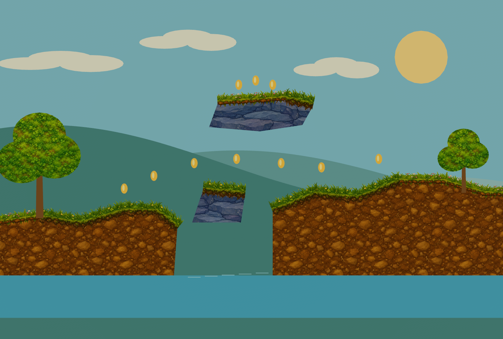

# Smart Shape 2D

Native Open Engine package for spline-authored 2D terrain and paths, textured borders, point anchors, static collision, and runtime destruction.

[Illustrated authoring manual](docs/authoring.mdx)



## Installation

This repository is the package root: `package.json`, `Native/`, and `Editor/` stay together. Add `smartshape2d` to the consuming project's `Packages/manifest.json` dependencies using a pinned git revision:

```json
{
  "dependencies": {
    "smartshape2d": "git+https://github.com/larssteenhoff/SmartShape2D.git#<commit>"
  }
}
```

Use an actual published commit in place of `<commit>`. The intended organization repository is [Game-Crafters-Guild/SmartShape2D](https://github.com/Game-Crafters-Guild/SmartShape2D); engine prerequisites are tracked in [OpenEngine #50](https://github.com/Game-Crafters-Guild/OpenEngine/pull/50). Current stock main is not yet a supported build of this package.

For local development, use `file:/absolute/path/to/SmartShape2D` as the dependency. Create shapes with **Create > Shape > Smart Shape** or **Smart Path**. Authoring uses the editor's standard Undo and Redo commands.

## Examples

Copy `Samples/GardenWorlds/Assets` and `Samples/GardenWorlds/AssetDatabase.assetdb` into a new project, add the package dependency, and open one of the four scenes. The asset database preserves material and texture identities. The artwork sources in `Sources/Textures` and manual screenshots use lossless WebP. Runtime textures use sRGB RGBA8 KTX2 with Zstandard compression and a full mip chain because the engine does not decode WebP textures. Texture GUIDs are preserved; level-zero pixels and alpha are unchanged.

## Tests

Configure an engine checkout containing the prerequisite fixes with `BUILD_TESTING=ON` and `CMAKE_PROJECT_INCLUDE=/absolute/path/to/SmartShape2D/Tests/AttachToEngine.cmake`. This attaches the package's runtime tests and editor integration tests without editing engine CMake files. Build `SmartShape2DTests` and `EditorTests`; run each whole suite from the engine build directory. Test results for an older engine revision do not establish compatibility with newer SDKs.

## Regenerating sample textures

The source files are the lossless WebP images in `Sources/Textures`. Runtime files in `Samples/GardenWorlds/Assets/Textures` are KTX2 containers with `VK_FORMAT_R8G8B8A8_SRGB`, Zstandard level 9 compression, and successive half-size box-filtered mip levels down to 1×1. Keep the level-zero RGBA pixels and the asset GUIDs unchanged when regenerating a container. The illustrated manual images need no texture conversion.

## Licenses

The upstream SmartShape2D MIT license is in [LICENSE](LICENSE). Clipper2's Boost Software License and attribution are in [THIRD_PARTY_NOTICES.md](THIRD_PARTY_NOTICES.md) and `Native/clipper2/LICENSE`.
